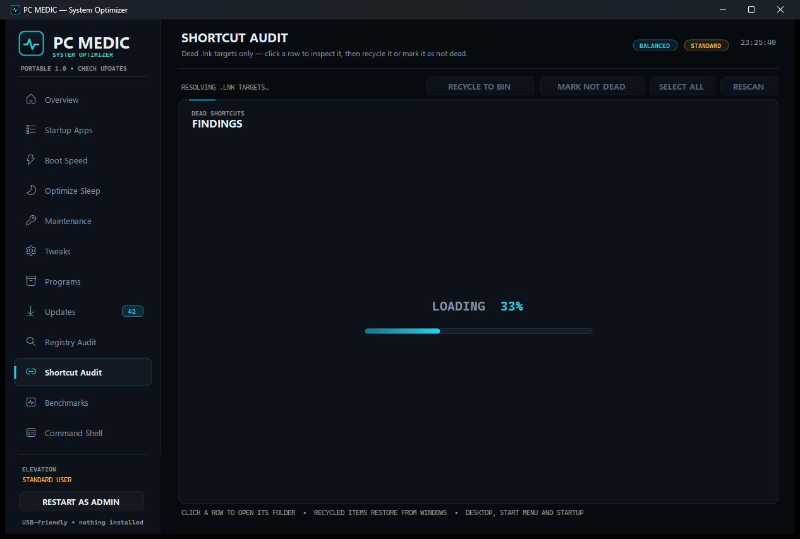

# PC Medic — portable Windows system optimizer and PC cleaner

[](https://github.com/DwainSnickles/pc-medic/releases/latest)

**PC Medic** is a portable Windows 10/11 maintenance suite for people who want the jobs
"Advanced SystemCare", CCleaner, Glary Utilities or Ashampoo WinOptimizer do — without a
background service, an installer, telemetry or a subscription. One folder, one executable,
every destructive action reversible through the Recycle Bin or a backup file.

Companion project: **[Disk Defrag](https://github.com/DwainSnickles/disk-defrag)** — a
separate cluster-map defragmentation tool that lives beside PC Medic and launches from its
Maintenance page.



## What it does

| Page | Purpose |
| --- | --- |
| **Overview** | Live CPU / memory / disk / uptime / update telemetry, GPU and machine profile, plus one-click **REDUCE CPU**, **FREE MEMORY**, **CLEAN DRIVE** and **OPEN UPDATES** actions. |
| **Startup Apps** | Every Run-key, Startup-folder and scheduled-task autostart entry, with reversible disabling. |
| **Boot Speed** | MenuShowDelay and boot-menu tuning with a JSON backup of the previous values. |
| **Optimize Sleep** | Sleep/hibernate and power-plan tuning through `powercfg`. |
| **Maintenance** | Fifteen recovery and cleanup tools (SFC, DISM, restore point, Storage Sense, Memory Diagnostic, Event Viewer, **Disk Defrag**) launched from one grid. |
| **Tweaks** | Explorer and visual-effects tweaks, each written with a backup so it can be reverted. |
| **Programs** | Installed applications from both registry hives, with uninstall and repair routing. |
| **Updates** | `winget` application upgrades and Windows Update driver scans with a shared badge count. |
| **Registry Audit** | Dead `App Paths`, orphaned uninstall keys and stale file associations, removable per item. |
| **Shortcut Audit** | Resolves ~25,000 shortcuts with `IShellLinkW`, flags dead links, recycles them, and keeps a persistent "not dead" list. |
| **Benchmarks** | Quick CPU and disk sanity runs. |
| **Command Shell** | An embedded console for the tools the UI does not wrap. |

## Why it is different

- **Portable and honest** — `asInvoker`, no service, no drivers, no scheduled tasks of its own.
  Elevation is opt-in per action and the UI always shows whether you are a standard user.
- **Reversible** — deleted files go to the Recycle Bin, registry edits write a backup first,
  and the shortcut keep-list and CPU-ceiling backup persist in `%LOCALAPPDATA%\PCMedic`.
- **No fake numbers** — every figure comes from the OS: `GlobalMemoryStatusEx`,
  `FSCTL_GET_VOLUME_BITMAP`, `powercfg`, `winget`, performance counters.

## Requirements

- Windows 10 or 11 (x64)
- .NET 10 desktop runtime, or build from source with the .NET 10 SDK
- Administrator rights only for the actions that genuinely need them

## Build

```sh
dotnet build "PC Medic.csproj"
```

The portable layout lands in `bin/Debug/net10.0-windows/`. Build the companion tool from its
own repository and drop `DiskDefrag.exe` beside `PC Medic.exe`; the Maintenance tile picks it
up automatically and falls back to the Windows optimiser when it is absent.

## SEO / search terms

This project is the practical answer to searches such as:

`Advanced SystemCare alternative` · `IObit Advanced SystemCare free alternative` ·
`CCleaner alternative portable` · `Glary Utilities alternative` ·
`Ashampoo WinOptimizer alternative` · `Wise Care 365 alternative` ·
`free PC cleaner Windows 11` · `portable system optimizer` · `startup program manager` ·
`registry cleaner open source` · `disk cleanup tool` · `Windows maintenance utility`

## Repository topics

`windows` `system-optimizer` `pc-cleaner` `pc-optimizer` `maintenance` `registry-cleaner`
`startup-manager` `disk-cleanup` `disk-defrag` `winforms` `dotnet` `windows-11` `portable`
`advanced-systemcare-alternative` `ccleaner-alternative` `freebuff`

---

Built with **[Freebuff](https://freebuff.com)** — the AI coding agent that builds and
maintains this suite.
